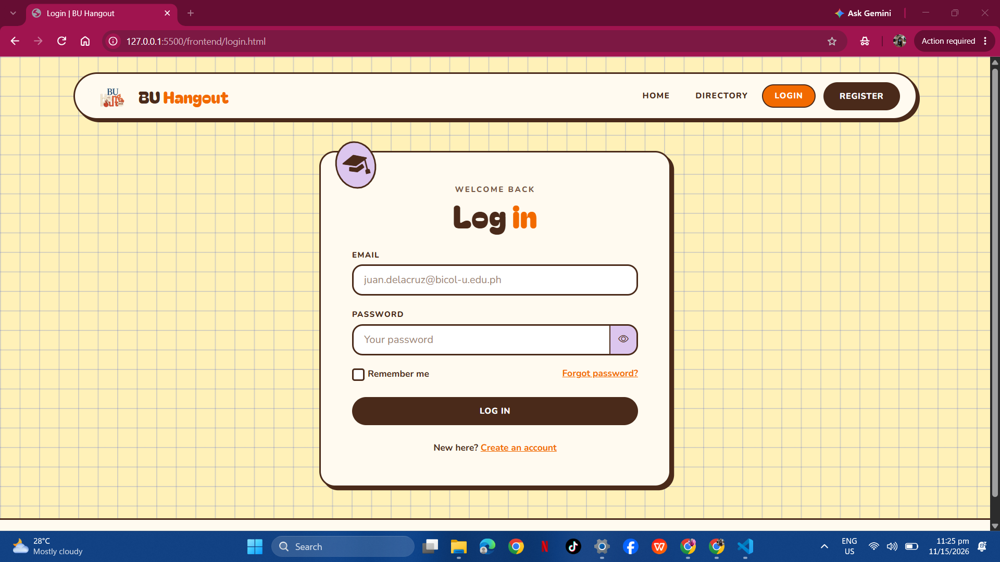
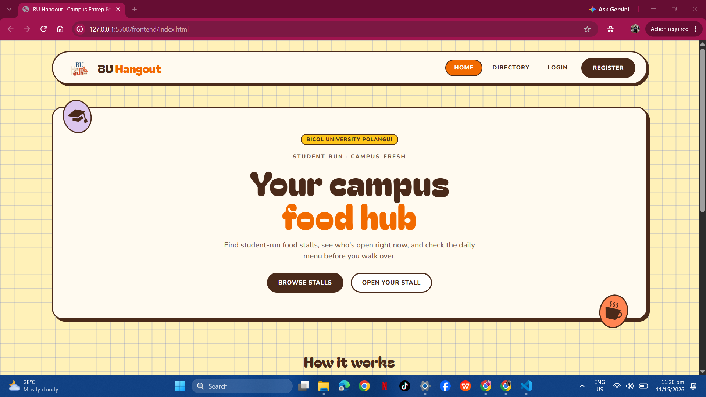
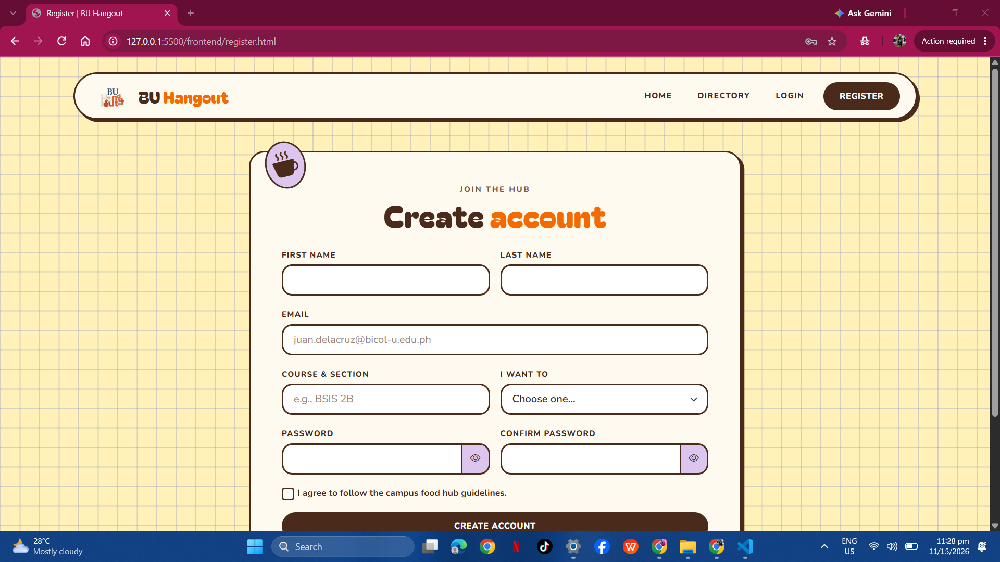
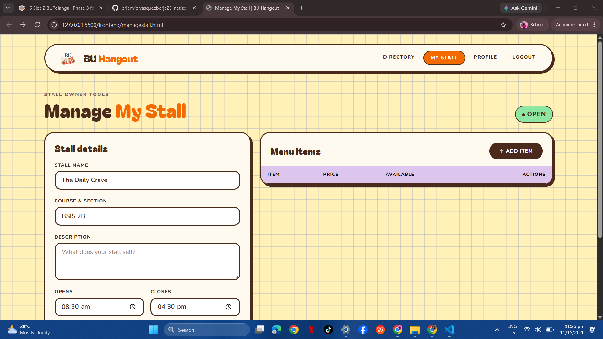
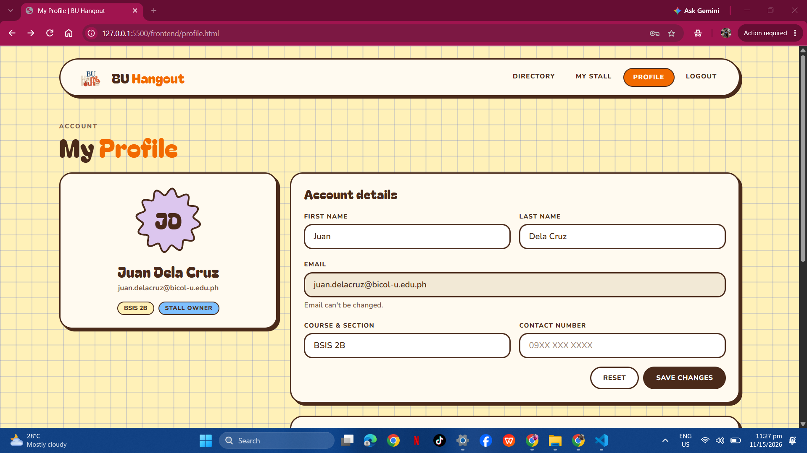

<div align="center">

# BU Hangout

**Integrated Food Stall Directory and Digital Menu System**

*Discover campus food options and help student entrepreneurs manage their stalls at Bicol University – Polangui.*

[](https://bu-hangout-group-2.vercel.app/)


**Bicol University – Polangui** · Computer Studies Department · BSIS 2B · Group 2

</div>

---

## Project Overview

BU Hangout (originally proposed as **BU EntrepHub**) is a web-based campus food stall directory and digital menu platform developed for Bicol University – Polangui. It connects student consumers with student entrepreneurs by making food stall information and menu offerings easier to discover. Consumers can browse stalls, check operating status and payment information, and explore menu items. Stall owners can use the management interface to maintain their stall details and menu.

The project consists of a static, responsive frontend and a Node.js/Express REST API backed by MongoDB.

## Live Demo

- **Frontend:** [https://bu-hangout-group-2.vercel.app/](https://bu-hangout-group-2.vercel.app/)
- **Backend health check:** [https://bufoodhub.onrender.com/health](https://bufoodhub.onrender.com/health)

The backend root endpoint (`/`) also returns a plain-text API status message. Availability of the hosted services depends on their deployment configuration.

## Features

### Consumer experience
- Browse the campus food stall directory.
- Search and filter stall listings.
- View stall open/closed status and GCash payment indicators.
- Preview digital menu items and their availability.

### Stall and account management
- Register and log in to an account.
- View and manage a user profile.
- Maintain stall details, including section, description, operating hours, open status, and GCash availability.
- Add and edit menu items, including prices and availability.

### Backend and data management
- REST API routes for authentication, users, stalls, and menu items.
- MongoDB data persistence through Mongoose models.
- Environment-based database and CORS configuration.
- Health-check endpoint for deployment monitoring.

> Feature availability is determined by the current implementation and connected deployment configuration.

## Technologies Used

| Area | Technologies |
|---|---|
| Frontend | HTML5, CSS3, JavaScript (Vanilla) |
| UI and icons | Bootstrap 5.3.3, Bootstrap Icons |
| Backend | Node.js, Express.js |
| Database | MongoDB Atlas, Mongoose |
| Configuration / middleware | dotenv, CORS |
| Deployment | Vercel (frontend), Render (backend) |
| API testing | Postman |

## Project Structure

```text
BU-Hangout/
├── Backend/
│   ├── Controllers/       # Authentication, user, stall, and menu logic
│   ├── Models/            # Mongoose schemas
│   ├── Routes/            # REST API route definitions
│   ├── config/            # MongoDB connection
│   ├── server.js          # Express application entry point
│   ├── package.json
│   └── .env.example       # Environment variable template
├── Frontend/
│   ├── css/               # Application styles
│   ├── img/               # Branding assets
│   ├── js/                # Frontend scripts
│   └── *.html             # Application pages
├── docs/                  # Project phase documents and screenshots
├── .gitignore
└── README.md
```

## Installation and Local Setup

### Prerequisites

- [Node.js](https://nodejs.org/) (LTS recommended) and npm
- A [MongoDB Atlas](https://www.mongodb.com/atlas) database, or another MongoDB connection URI
- Git (optional, for cloning the repository)

### 1. Get the source code

```bash
git clone <your-repository-url>
cd final-project-Group2-BSIS2B-main
```

Alternatively, download and extract the repository ZIP, then open the extracted project folder in your editor.

### 2. Configure the backend

```bash
cd Backend
npm install
```

Copy `.env.example` to `.env` and replace the placeholder database URI with your MongoDB connection string. Set `CLIENT_ORIGINS` to the exact origin(s) serving your frontend (comma-separated, without trailing slashes).

Example `.env` configuration:

```env
PORT=5000
MONGODB_URI=mongodb+srv://<username>:<password>@<cluster-url>/<database-name>
CLIENT_ORIGINS=http://localhost:5500,https://your-frontend-domain.example
NODE_ENV=development
```

Do not commit `.env` or publish database credentials. Ensure your MongoDB Atlas network access rules allow connections from your deployment environment.

### 3. Start the backend

From the `Backend` directory, run:

```bash
npm start
```

For development with automatic restarts:

```bash
npm run dev
```

The API defaults to `http://localhost:5000`. Check `http://localhost:5000/health` to verify that the server is responding.

### 4. Run the frontend

Serve the `Frontend` directory using a local development server (for example, the VS Code Live Server extension). Open `index.html` through that server rather than relying on a `file://` URL. Add the local frontend origin (commonly `http://127.0.0.1:5500` or `http://localhost:5500`) to `CLIENT_ORIGINS` in the backend `.env` file, then restart the backend.

If your frontend JavaScript uses a configured API base URL, ensure it points to `http://localhost:5000` for local development.

## API Overview

| Method | Endpoint | Purpose |
|---|---|---|
| `POST` | `/api/auth/login` | Authenticate a user |
| `GET`, `POST` | `/api/users` | List and create users |
| `PUT`, `DELETE` | `/api/users/:id` | Update or delete a user |
| `GET`, `POST` | `/api/stalls` | List and create stalls |
| `PUT`, `DELETE` | `/api/stalls/:id` | Update or delete a stall |
| `GET` | `/api/menu` | List menu items; supports `stallId` filtering |
| `POST` | `/api/menu/add` | Add a menu item |
| `PUT` | `/api/menu/:id` | Update a menu item |
| `GET` | `/health` | Backend health check |

## Screenshots

Screenshots below are from the project documentation in `docs/lab11/`.

| Landing / Login | Stall Directory |
|---|---|
|  |  |

| Registration | Stall Management |
|---|---|
|  |  |

| User Profile |
|---|
|  |

## Contributors

| Contributor | Role |
|---|---|
| **Jielaine Roz I. Atienza** | Project Manager |
| **Kristelle Joy N. De Jesus** | Frontend Developer & Database Manager |
| **Raiver L. Sarte** | Backend Developer |
| **Brian Viel V. Borje** | GitHub Manager |
| **Paula Jane J. Gonzales** | Tester & Documentation |

## Academic Information

- **Institution:** Bicol University – Polangui
- **Department:** Computer Studies Department
- **Program / Section:** BSIS 2B
- **Course:** IS ELEC 2 – Web Systems and Technologies
- **Instructor:** Prof. Guillermo V. Red, Jr.
- **Academic Year:** 2025–2026
